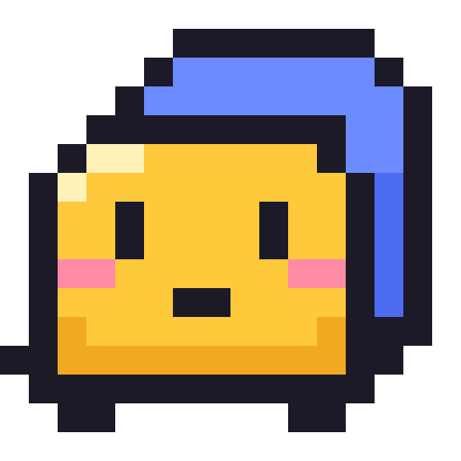

# TooManyTabs brand

**The idea:** a little pixel world for your tabs. Pip lives in it, the user picks the weather (a palette), and the page is built from stair-stepped tones, chunky buttons and tiny sprites. It is playful but never noisy: one primary button, plain readable rows, nothing looping.

## Name: keep **TooManyTabs**
We kept the name. It says the problem in the user's own words, it's memorable and a little funny, and it already matches the GitHub repo and the extension ID. Renaming would cost those for no clear gain.
- **In the UI** the wordmark is lowercase `toomanytabs`, set in the pixel face.
- **In prose** it's written TooManyTabs.
- No migration is needed because nothing was renamed.

## Mascot: Pip
- **What Pip is:** a small yellow browser tab with a face, carrying a spare blue tab on its back, since there are always too many.
- **The grid:** Pip is drawn on a real 16×16 pixel grid in `src/brand/pip.json`, the single source of truth.
  - `npm run brand` turns it into `public/icons/icon-{16,32,48,128}.png`, `public/brand/pip.svg` and `pip-512.png`.
  - Each size is an integer multiple of the grid, so every pixel stays crisp.
  - Chrome needs PNG icons; SVG isn't accepted for extension icons.
- **Moods (`src/components/brand/Pip.tsx`):**
  - `idle`;
  - `happy`: ^ ^ eyes and a smile, for about 1.4 s after saving or closing, with a single hop;
  - `sleepy`: when there's nothing at all;
  - `surprised`: when a search finds nothing.
- **Motion:** Pip never loops or idles.
- **Original art:** Pip was made for this project and isn't based on any existing character.

## Colour: six palettes
The user picks a **palette** (Settings → Look, the swatches in the sidebar, or ⌘K) and separately a **mode** (system, light, dark). `<html>` carries `data-palette` and `data-theme`. A palette only sets raw colours; everything else derives from them.

| Palette | Feel | Light brand | Dark brand |
|---|---|---|---|
| **Pip** (default) | butter and cream | `#FFC93C` | `#FFC93C` |
| **Dusk** | twilight violet | `#9B7BFF` | `#B79CFF` |
| **Mint** | fresh leaves | `#3DCB93` | `#4FE0A8` |
| **Peach** | warm sunset | `#FF7F61` | `#FF9478` |
| **Sky** | clear morning | `#5AA6FF` | `#6FB1FF` |
| **Bubblegum** | sweet and loud | `#FF72B4` | `#FF8DC4` |

Tokens (all in `src/index.css`; `src/lib/palettes.ts` mirrors the raw colours for previews and `tests/palettes.test.ts` fails if they drift):

| Token | Use |
|---|---|
| `ground` | the page (with a faint pixel-dot grid) |
| `panel` / `panel-hover` | cards and rows on hover (white-ish in light, `raised` in dark) |
| `raised`, `raised-2` | fields, tracks, chips |
| `float` | menus, dialogs, the selected segment |
| `ink`, `ink-2`, `ink-3` | text (100 / 70 / 58%); never invent a fourth |
| `brand`, `on-brand`, `brand-soft` | the selected nav item, the meter, chips, the primary button's lip, Pip's banner |
| `link` | focus ring, links |
| `pick` | the highlight tint inside menus |
| `edge` | the hard pixel shadow |
| `danger` | destructive items and errors only |

**Pip himself is always yellow.** He is the one constant; the world around him changes colour.

**Mascot palette** (`pip.json`):
- ink outline `#1C1A27`;
- body `#FFC93C`, shade `#F2A922`, highlight `#FFF1B8`;
- blush `#FF8AA6`;
- back tab `#6C8BFF` / `#4C6BEF`.

## Typography
| Role | Face | Licence | Where |
|---|---|---|---|
| Display | **Pixelify Sans** (variable 400–700) | SIL OFL 1.1, no Reserved Font Name | wordmark, empty-state headlines; never body text |
| UI | **Atkinson Hyperlegible Next** (variable 200–800, roman + italic) | SIL OFL 1.1, no Reserved Font Name | everything else: 15 px body, 13 px meta |

- Both are vendored in `public/fonts`, with their licence texts in `public/fonts/licenses`. They are listed in `/THIRD_PARTY.md`.
- Atkinson was designed by the Braille Institute for legibility. Its distinct letterforms (Il1, 0O) suit long lists of page titles.

## Pixel language
Everything is built from a few pixel ideas, so it feels like one little game world and not a flat web page.

- **Stair-step corners.** A surface is a tone plus four hard box-shadows in its own colour (`.pix` 4px, `.pix-m` 3px, `.pix-s` 2px, set per surface with `--pc`). No radius, no border. Sibling gaps must be larger than the notch.
- **Hard shadows.** Floating things (`.pix-float`) and cards (`.pix-card`) drop a hard, un-blurred shadow that follows the notch.
- **Chunky buttons.** `.pix-btn` has a coloured lip. The primary ink button's lip is the palette's brand colour. Pressing drops the face 2px and squashes the lip.
- **Pixel font** (Pixelify Sans, `font-display`): the wordmark, page and section titles, the settings pane titles, counts in the meter, empty-state headlines. Never body text or buttons.
- **Sprites** (`src/components/brand/Sprite.tsx`): tiny text-grid pixel art in theme colours. One-colour `nav*` sprites are icons that take the text colour; the rest (window, stack, moon, star, heart, cloud, spark) are decoration.
- **Pip's world** (`Scene`): a 48×14-cell landscape that sits under the sidebar at exactly 6px per cell, and runs as a mirrored strip in empty states. It can be switched off in Settings.
- **The tab level meter**: 16 chunky cells and a one-word mood (all clear, calm, cozy, busy, too many, way too many).
- Pixel UI moves in whole pixels: steps, not glides.

## Layout
- **From 1024px:** a 288px sidebar (brand card, the one primary button, All / Open now / Saved, shelves, tab level, theme swatches, Commands, mode, Settings, the landscape) and a main column up to 920px with a search field, a pixel-font page title, Pip's suggestion, then each shelf as a card.
- **Below 1024px:** one column. The sidebar collapses into a header with search, a segmented view switch and a shelf select.
- Density (Cozy or Compact) only changes rows.

## Shape and motion
- **Radius:** none. Corners are stair-stepped (see above). The old 6 / 8 / 12 / 14 ladder is gone.
- **One motion per kind:**
  - rows: 180 ms rise, first paint only;
  - menus: 120 ms grow;
  - dialogs: 240 ms rise, 120 ms fade out;
  - buttons: 2px drop on press;
  - switch thumb and Pip's hop: stepped, like a sprite.
- **Ease** is `cubic-bezier(0.22, 1, 0.36, 1)` for everything that isn't stepped.
- **Reduced motion** keeps only the fades. Nothing loops at rest.

## Voice
- Sentence case, few words, and verbs that say what happens.
- The toast echoes the button: "Save 12 tabs" → "Saved 12 tabs to Later".
- An error says what to do next. Empty states invite an action.

## Don'ts
- No gradients and no blurred shadows. The only background texture is the faint dot grid.
- No border and shadow-ring on one surface other than the pixel notch itself.
- No chip rows of filters, and no more than one ink primary button per view.
- Never colour text with `brand`. It's a fill, and it needs `on-brand` text on top.
- The pixel font is never used for body text, buttons or row titles.
- Don't copy another product's art, CSS or copy. Principles only.
